# 咖啡店的相遇（範例） — 影片 AI 提示詞

- 目標模型 Preset：**Seedance 2.0**
- 畫面比例 ratio：`adaptive`（首尾幀 1920×1080 px）
- 風格 Style：cinematic realistic, natural lighting
- 使用方式：在 Seedance 2.0 選「首尾幀」，上傳 `shot_XX_start.png` 為首幀（@Image1 / @图片1）、`shot_XX_end.png` 為尾幀（@Image2 / @图片2），時長與比例依下表設定，貼上英文或中文提示詞。沒有尾幀的鏡頭只上傳首幀。

### 深度圖 Depth maps（`shot_XX_start_depth.png` / `shot_XX_end_depth.png`）

- 灰階、**近 = 白、遠 = 黑**（MiDaS / ControlNet depth 慣例的相對深度），尺寸與首尾幀相同、逐像素對齊；由場景幾何（地面、道具、人偶實心體積）算出，不是從圖片估計。
- **ControlNet depth**（ComfyUI、Stable Diffusion WebUI / Forge、SDXL / Flux depth ControlNet、AnimateDiff / Wan 等影片管線）：把深度圖接到 depth ControlNet，preprocessor 選 **none**（已經是深度圖，不要再跑 MiDaS / Depth Anything），control weight 約 0.4–0.7；首幀深度圖控制首幀構圖，尾幀深度圖用於結束畫面或關鍵幀。
- **Seedance 2.0**：首尾幀模式只接受首幀＋尾幀，**不能同時加參考圖**；要用深度圖時改用「全能參考 / 多模態參考」（最多 9 張圖），例如：`@Image1 為首幀構圖參考，@Image2 為深度與空間配置參考，保持人物位置與前後景深，生成寫實畫面`。Seedance 沒有官方的 depth 控制，深度圖只會被當作一般參考圖理解，效果不保證；較穩定的作法是先用 ControlNet depth 把首尾幀生成寫實圖，再把寫實首尾幀交給 Seedance 2.0 首尾幀模式。

## 鏡頭 01：咖啡店門口

| 首幀 | 尾幀 |
|---|---|
| 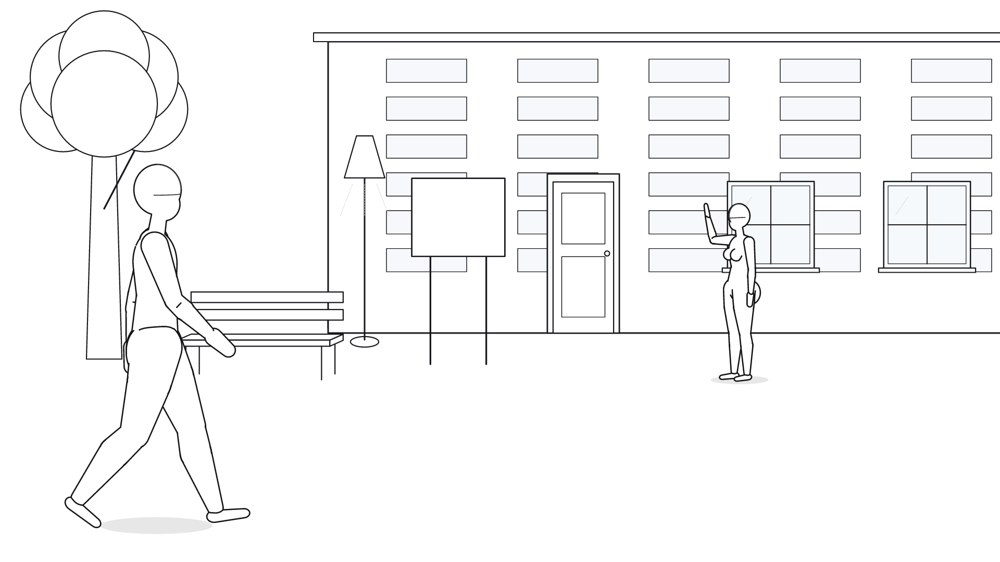 | 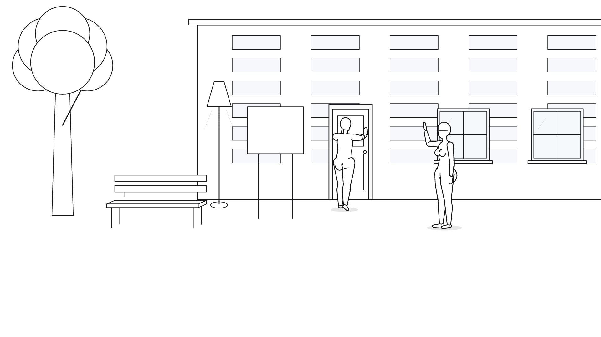 |

| 首幀深度圖 | 尾幀深度圖 |
|---|---|
| 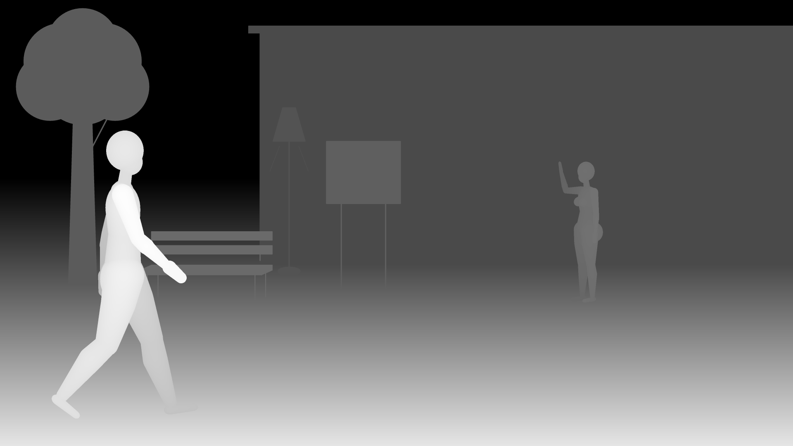 | 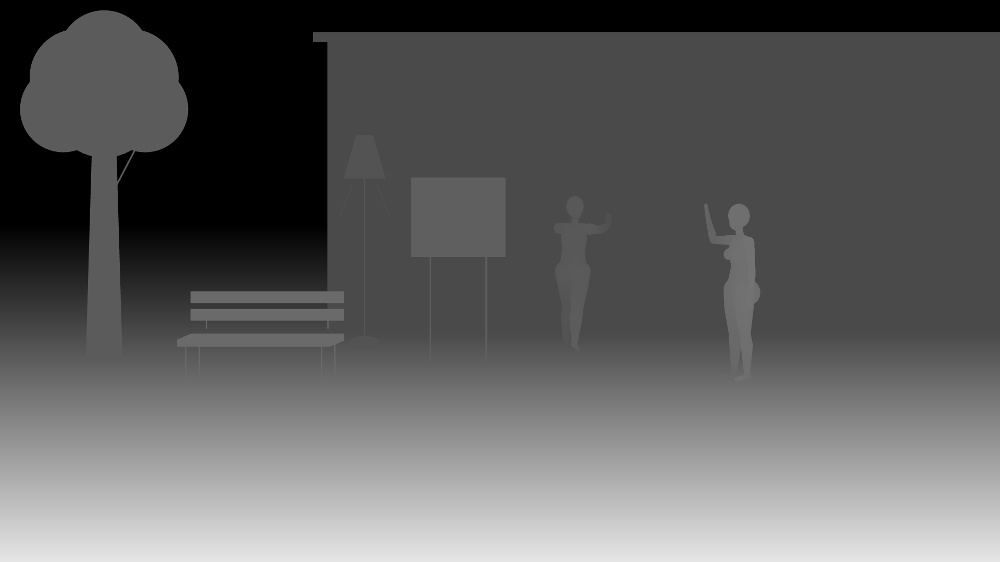 |

- 時長 duration：**4 秒**（分鏡 4.0 秒）
- 比例 ratio：`adaptive`
- 音訊 generate_audio：true

**English**（115 words）

```text
@Image1 as the first frame, @Image2 as the last frame; generate the motion between them. People: 小明 (male student, 20, short black hair, grey hoodie, backpack); 小美 (female barista, 22, ponytail, brown apron). 小明: left foreground, profile facing right, walking; 0-3s walks toward screen right and away from the camera to the center midground, then pushing, back to camera. 小美: right midground, 3/4 view facing left, waving. 小明 thinks silently (voice-over): "今天一定要試試新口味……". 小美 says: "嗨！今天也是老樣子嗎？". Voice-over: "午後的街角，陽光灑在咖啡店的招牌上。小明一如往常，快步走向那扇熟悉的木門。". Setting: Exterior, afternoon, 街角「晨光咖啡」門口. Camera: full shot, eye level, slow smooth pan right. Duration 4 seconds. Style: cinematic realistic, natural lighting. The line-art mannequins are blocking reference only; render real people. Consistent faces, natural anatomy, no on-screen text.
```

**中文**

```text
@图片1 作為首幀，@图片2 作為尾幀，生成兩者之間連續的動作。人物：小明（20 歲台灣男大學生，黑色短髮，灰色帽 T、牛仔褲、黑色後背包）；小美（22 歲台灣女店員，綁馬尾，白襯衫配咖啡色圍裙，笑容親切）。小明在畫面左下方，面向畫面右側（側面），背著後背包，快步從畫面左側走向咖啡店大門；0–3 秒以「走」的方式向畫面右方、同時往畫面深處（遠離鏡頭），到達畫面正中央，改為推（門／物品），背對鏡頭（沿著人行道斜斜走向門口，最後伸手推門），表情期待、心情很好。小美在畫面右下方，斜向畫面左前方（3/4 側身），站在店門旁，看到小明後舉手揮手打招呼，表情微笑。小明的內心獨白（畫外音）："今天一定要試試新口味……"。小美說："嗨！今天也是老樣子嗎？"。旁白（畫外音）："午後的街角，陽光灑在咖啡店的招牌上。小明一如往常，快步走向那扇熟悉的木門。"。場景：外景，街角「晨光咖啡」門口，下午，晴朗，陽光斜照。安靜的巷弄，人行道旁有行道樹與長椅，咖啡店掛著木製招牌。鏡頭：全景、平視、向右搖攝。時長 4 秒。風格：cinematic realistic, natural lighting。畫面中的線稿人偶只是走位參考，請生成真實的人物（自然的皮膚、頭髮與服裝）。人物前後一致，臉孔與比例穩定，自然的人體結構，畫面乾淨、不出現任何文字。
```

## 鏡頭 02：店內櫃台點餐

| 首幀 | 尾幀 |
|---|---|
| 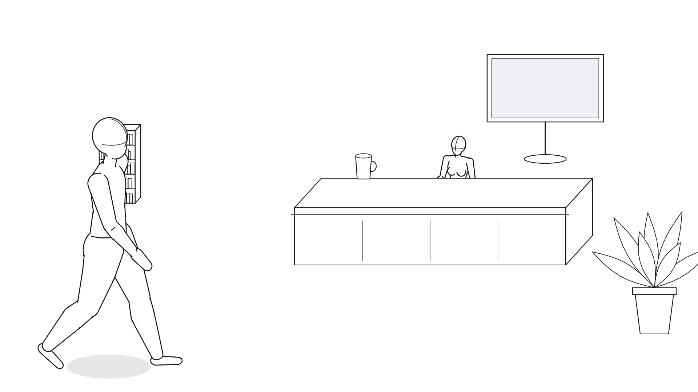 | 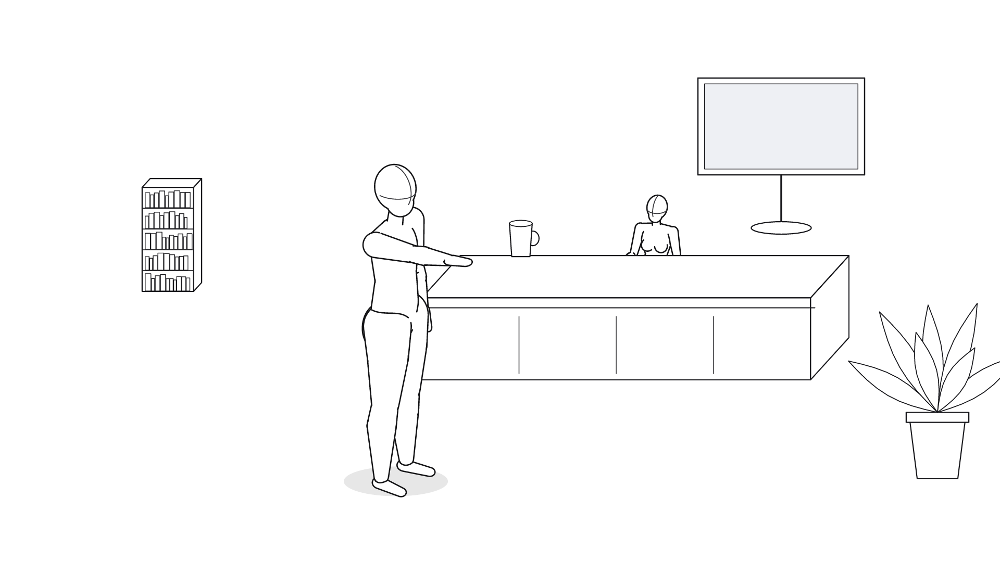 |

| 首幀深度圖 | 尾幀深度圖 |
|---|---|
| 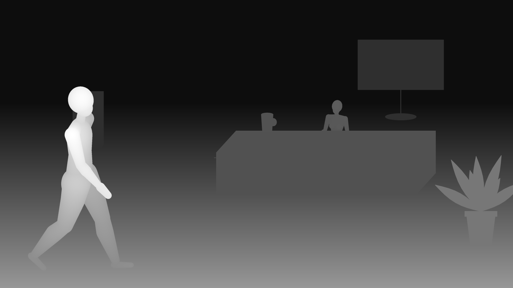 | 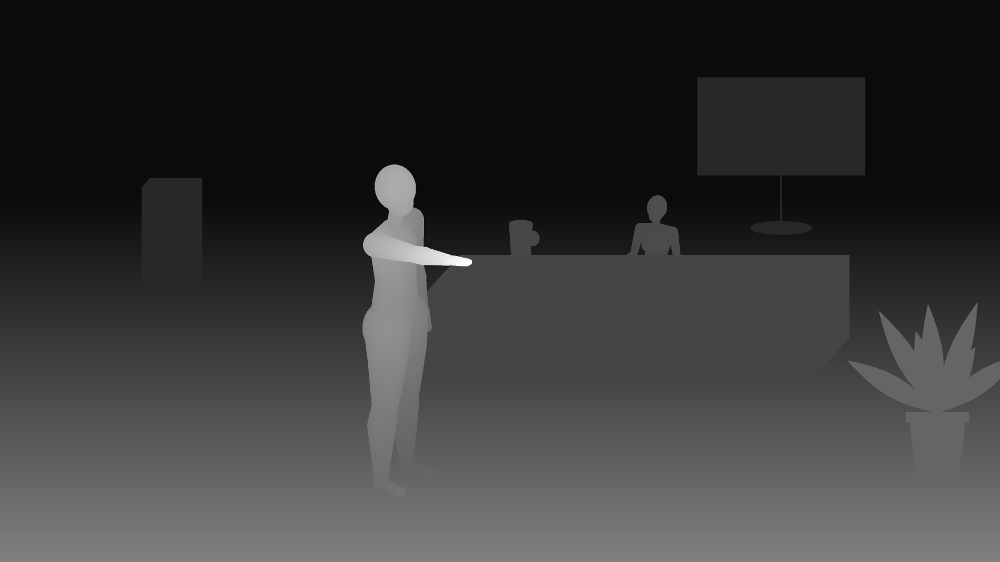 |

- 時長 duration：**5 秒**（分鏡 5.0 秒）
- 比例 ratio：`adaptive`
- 音訊 generate_audio：true

**English**（108 words）

```text
@Image1 as the first frame, @Image2 as the last frame; generate the motion between them. People: 小美 (female barista, 22, ponytail, brown apron); 小明 (male student, 20, short black hair, grey hoodie, backpack). 小美: center midground, facing the camera, talking / gesturing. 小明: left foreground, profile facing right, walking; 0-2s strolls toward screen right and away from the camera to the center foreground, then pointing. 小美 says: "一杯拿鐵、少冰，對吧？". 小明 shouts: "對！再加一份肉桂！". Setting: Interior, afternoon, 晨光咖啡店內・吧台. Camera: medium wide shot, high angle, slow push-in. Duration 5 seconds. Style: cinematic realistic, natural lighting. The line-art mannequins are blocking reference only; render real people. Consistent faces, natural anatomy, no on-screen text.
```

**中文**

```text
@图片1 作為首幀，@图片2 作為尾幀，生成兩者之間連續的動作。人物：小美（22 歲台灣女店員，綁馬尾，白襯衫配咖啡色圍裙，笑容親切）；小明（20 歲台灣男大學生，黑色短髮，灰色帽 T、牛仔褲、黑色後背包）。小美在畫面正中央，正面朝向鏡頭，站在吧台後方，一邊聽點餐一邊比手勢。小明在畫面左下方，面向畫面右側（側面），走到吧台前，伸手指向牆上的菜單；0–2 秒以「慢慢踱步」的方式向畫面右方、同時往畫面深處（遠離鏡頭），到達畫面下方正中，改為指向前方（慢慢走到吧台前，停下來指向菜單）。小美說："一杯拿鐵、少冰，對吧？"。小明大喊："對！再加一份肉桂！"。場景：內景，晨光咖啡店內・吧台，下午，室內暖色燈光。木質吧台、牆上的菜單螢幕與書櫃，空氣中有咖啡香。鏡頭：中遠景、俯視、推鏡（推近）。時長 5 秒。風格：cinematic realistic, natural lighting。畫面中的線稿人偶只是走位參考，請生成真實的人物（自然的皮膚、頭髮與服裝）。人物前後一致，臉孔與比例穩定，自然的人體結構，畫面乾淨、不出現任何文字。
```

## 鏡頭 03：靠窗的座位

| 首幀 | 尾幀 |
|---|---|
| 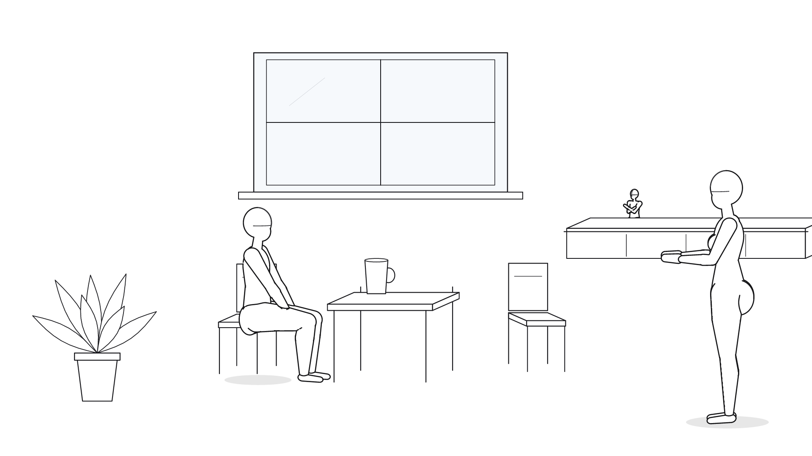 | 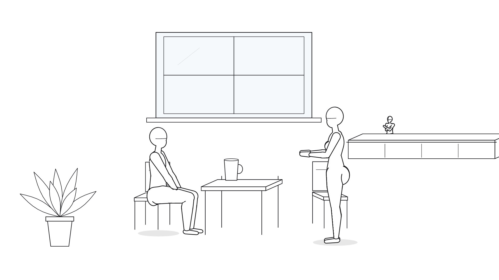 |

| 首幀深度圖 | 尾幀深度圖 |
|---|---|
| 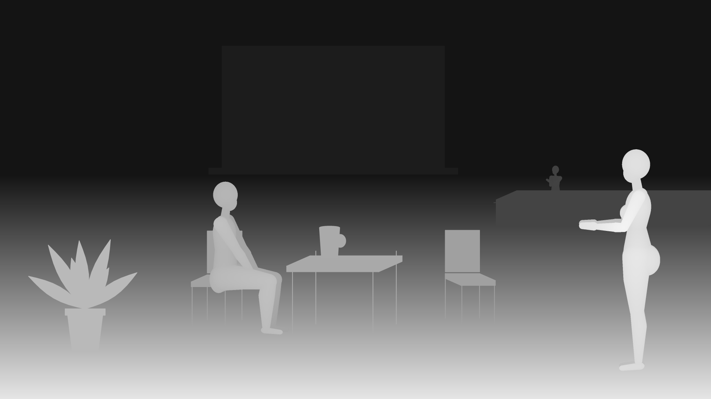 | 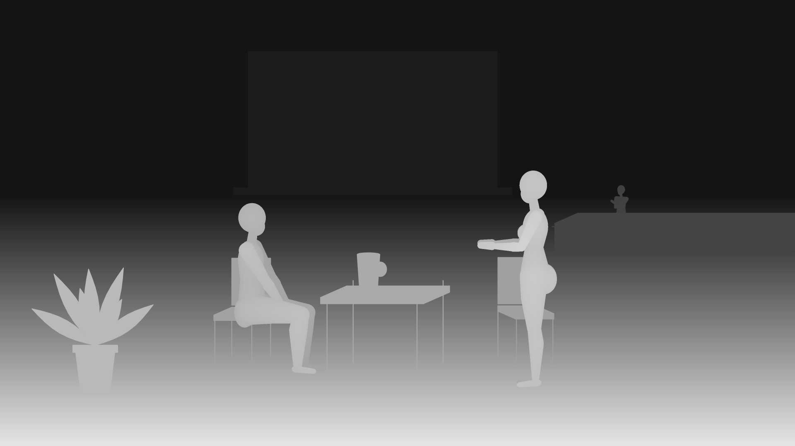 |

- 時長 duration：**6 秒**（分鏡 6.0 秒）
- 比例 ratio：`adaptive`
- 音訊 generate_audio：true

**English**（126 words）

```text
@Image1 as the first frame, @Image2 as the last frame; generate the motion between them. People: 老陳 (café owner, 50s, grey hair, black shirt); 小明 (male student, 20, short black hair, grey hoodie, backpack); 小美 (female barista, 22, ponytail, brown apron). 老陳: right background, 3/4 view facing left, arms crossed. 小明: left foreground, profile facing right, sitting on a chair. 小美: right foreground, profile facing left, carrying; 0-4s walks toward screen left and away from the camera to the right foreground. Voice-over narration: "店長老陳默默記下：這是小明的第 100 杯拿鐵。". 小美 whispers: "請慢用，今天的拉花是愛心喔。". Setting: Interior, dusk, 晨光咖啡店內・靠窗座位. Camera: medium wide shot, eye level, fixed camera. Duration 6 seconds. Style: cinematic realistic, natural lighting. The line-art mannequins are blocking reference only; render real people. Consistent faces, natural anatomy, no on-screen text.
```

**中文**

```text
@图片1 作為首幀，@图片2 作為尾幀，生成兩者之間連續的動作。人物：老陳（50 多歲台灣咖啡店老闆，灰白短髮，捲起袖子的黑襯衫，神情沉穩）；小明（20 歲台灣男大學生，黑色短髮，灰色帽 T、牛仔褲、黑色後背包）；小美（22 歲台灣女店員，綁馬尾，白襯衫配咖啡色圍裙，笑容親切）。老陳在畫面右側中段，斜向畫面左前方（3/4 側身），在吧台後雙手抱胸，看著兩人，表情嘴角微微上揚。小明在畫面左下方，面向畫面右側（側面），坐在窗邊的椅子上，轉頭看向走過來的小美，表情驚喜。小美在畫面右下方，面向畫面左側（側面），雙手捧著拿鐵，從右側走向桌邊；0–4 秒以「走」的方式向畫面左方、同時往畫面深處（遠離鏡頭），到達畫面右下方（小心地端著咖啡走到桌邊）。旁白（畫外音）："店長老陳默默記下：這是小明的第 100 杯拿鐵。"。小美小聲地說："請慢用，今天的拉花是愛心喔。"。場景：內景，晨光咖啡店內・靠窗座位，黃昏，夕陽從窗外照進來。窗邊的小圓桌與兩張椅子，窗外是逐漸變暗的街道。鏡頭：中遠景、平視、固定鏡頭。時長 6 秒。風格：cinematic realistic, natural lighting。畫面中的線稿人偶只是走位參考，請生成真實的人物（自然的皮膚、頭髮與服裝）。人物前後一致，臉孔與比例穩定，自然的人體結構，畫面乾淨、不出現任何文字。
```
